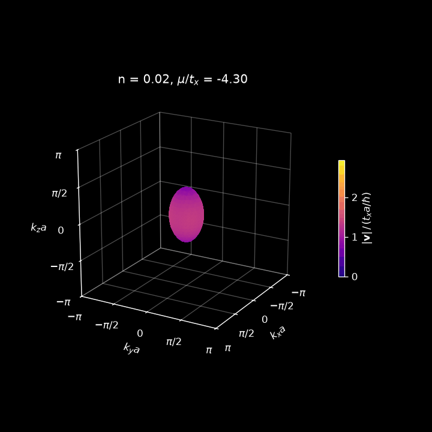

# Fermi surfaces using MLX
This fills an anisotropic tight-binding band with electrons and follows its Fermi surface as it changes topology, counting every Bloch state on an Apple GPU with MLX and checking the count against the textbook effective-mass formulae.

## The Fermi surface, $E(\mathbf{k}) = \mu(n)$

<p align="center">
  
</p>

Fermi surface of the anisotropic single-band tight-binding model in the first Brillouin zone for $0.02 \le n \le 1.98$, coloured by $|\mathbf{v}|$ from (5). It changes topology at $n = 0.139$, $0.700$, $1.300$ and $1.861$.

## Band theory

The Fermi surface is the set $\lbrace \mathbf{k} : E(\mathbf{k}) = \mu(n) \rbrace$, computed for a simple cubic lattice with lattice parameter $a$ and a single orbital per atom, whose electrons hop between neighbouring atoms with transfer integrals $t_x = t_y$ and a weaker $t_z = 0.4\,t_x$ between layers, with energies in units of $t_x$. The equations follow from Singleton, *Band Theory and Electronic Properties of Solids*.

The band at wavevector $\mathbf{k}$ is

$$E(\mathbf{k}) = -2t_x \cos(k_x a) - 2t_y \cos(k_y a) - 2t_z \cos(k_z a) \tag{1}$$

Near the minimum $E_0$, $\cos(k_i a) \approx 1 - \tfrac{1}{2}(k_i a)^2$, so (1) becomes $E \approx E_0 + \sum_i t_i a^2 k_i^2$. Matching each term to a free electron (the Sommerfeld model), $E = \hbar^2 k_i^2 / 2m_i$, gives the effective masses and the density-of-states mass $m^*$

$$m_i = \frac{\hbar^2}{2 t_i a^2}, \qquad m^* = (m_x m_y m_z)^{1/3} \tag{2}$$

Born–von Karman boundary conditions allow evenly spaced wavevectors $\mathbf{k}$ in the Brillouin zone, each an electron state with energy $E(\mathbf{k})$ from (1). Counting these states per unit energy gives the density of states $g(E)$, per unit cell per spin. Near $E_0$ the band is a free-electron band with mass $m^*$, so this count must approach the free-electron result

$$g(E) = \frac{a^3}{4\pi^2}\left(\frac{2m^*}{\hbar^2}\right)^{3/2}(E - E_0)^{1/2} \tag{3}$$

Electrons fill the lowest states first, each occupied with probability $f(E) = 1/(e^{(E - \mu)/k_B T} + 1)$. The number of electrons per unit cell $n$ is set by the atoms, and the level $\mu$ they fill up to follows from

$$n = 2\int \frac{g(E)}{e^{(E - \mu)/k_B T} + 1}\, dE \tag{4}$$

Solving (4) for $\mu$ at each $n$, with $k_BT = 0.01\,t_x$, the Fermi surface is $E(\mathbf{k}) = \mu$, on which electrons move with group velocity (the real-space motion of the electron), $\mathbf{v}$:

$$\mathbf{v} = \frac{1}{\hbar}\nabla_{\mathbf{k}} E \tag{5}$$

## Using MLX

The code finds $g(E)$ by placing a grid of points (electron states) across the Brillouin zone. It then counts how many states fall at each energy, with more points giving a more accurate count.

| Grid | States | Error against (3) |
|---|---|---|
| 64³ | 2.6 × 10⁵ | 3.6% |
| 512³ | 1.3 × 10⁸ | 1.2% |

The error is over $E - E_0 < 0.1\,t_x$. At 512³ the grid holds up to 2.7 × 10⁸ electrons. The remaining 1.2% is the cosine shape, not the grid. The animation draws the surface on a coarser 44³ grid, but takes $\mu$ from the 512³ count.

MLX runs this count on an Apple GPU in 0.09 s, against 2.3 s on the CPU, ~25x faster. Unified memory allows the CPU and GPU to share the result, so NumPy reads it without a transfer between devices.


## Run

Needs an Apple silicon Mac.

```bash
python3 -m venv .venv
source .venv/bin/activate
pip install -r requirements.txt
python surface.py
```

This prints the checks, saves `fermi_surface.gif` and plays the animation in a window.
